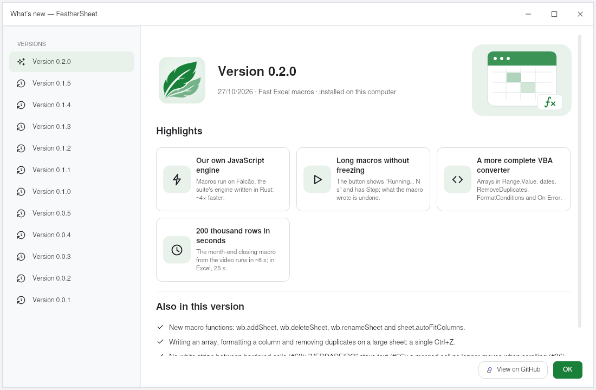

# FeatherSheet

**The spreadsheet of the FeatherWorks suite, written in Rust with a native pelicano interface.**
It opens huge files, calculates in parallel, takes formulas in Portuguese or English,
and runs entirely on your machine: no account, no login, no telemetry.

> **Status:** under active development. Alpha release planned for **10/30/2026**.


## Download

[](https://github.com/feather-works/feathersheet/releases/latest/download/FeatherSheet-windows-x64.exe)
[](https://github.com/feather-works/feathersheet/releases/latest/download/feathersheet-linux-amd64.deb)
[](https://github.com/feather-works/feathersheet/releases/latest/download/feathersheet-linux-x86_64.tar.gz)
[](https://github.com/feather-works/feathersheet/releases/latest)

| System | File | How to install |
|---|---|---|
| **Windows 10/11** | [FeatherSheet-windows-x64.exe](https://github.com/feather-works/feathersheet/releases/latest/download/FeatherSheet-windows-x64.exe) | run the installer (no administrator rights needed) |
| **Linux** (Ubuntu, Debian, Mint…) | [feathersheet-linux-amd64.deb](https://github.com/feather-works/feathersheet/releases/latest/download/feathersheet-linux-amd64.deb) | `sudo apt install ./feathersheet-linux-amd64.deb` |
| **Linux** (any distribution) | [feathersheet-linux-x86_64.tar.gz](https://github.com/feather-works/feathersheet/releases/latest/download/feathersheet-linux-x86_64.tar.gz) | extract it and run `./instalar.sh` |
| **macOS** (Apple Silicon) | `FeatherSheet-<version>-macos-apple-silicon.dmg`, on the [releases page](https://github.com/feather-works/feathersheet/releases/latest) | open the `.dmg` and drag it to Applications |

All versions and their checksums (`SHA256SUMS`) are on the
[releases page](https://github.com/feather-works/feathersheet/releases).
To update, download the new file and install over the old one: `apt` and
the Windows installer replace the previous version.

> v0.0.1 for Linux requires Ubuntu 26.04 or newer (glibc 2.43).

---

## New in v0.2.0: Excel macros

FeatherSheet opens an `.xlsm` with its VBA macro inside, converts it to
JavaScript on the fly and runs it. A month-end closing macro over 196 thousand
sales (cleaning names, fixing dates, computing commissions, highlighting
targets, a ranking and one sheet per region) runs in ~8 s; in Excel, the same
macro took 25 s.

- **Our own JavaScript engine:** macros run on [Falcão](https://github.com/feather-works/falcao), written from scratch in Rust (~4× faster than the previous engine).
- **A long macro doesn't freeze the window:** "Running… N s" and a **Stop** button that undoes what it wrote.
- **A more complete VBA converter:** block `Range.Value`, dates, `RemoveDuplicates`, `FormatConditions`, `On Error Resume Next`, `Worksheets.Add`, UserForms.



The same window opens by itself the first time after an update (and in the
Help menu, under *What's new*).

## What it does

| Area | Highlights |
|---|---|
| **Formulas** | all 520 Excel functions, with Portuguese or English names following the interface language; step-by-step formula evaluation; dynamic arrays, `LAMBDA`, volatile functions |
| **Big files** | up to 100 million rows; opens `.parquet` and large `.csv`; parallel calculation with selective invalidation; instant sum and count in the status bar; pasting a value into all 100 million rows of a column in 0.3 s; a formula over a whole 13.7-million-row column in milliseconds; pivot tables computed in the background, without freezing the window |
| **Excel** | opens and saves `.xlsx` with theme colors, shapes, images, gradients, charts in the right place, pivot tables and links to other files; opens `.xlsm`, converts the VBA macros to JavaScript and runs them, with buttons, shapes and UserForms |
| **Charts** | 25 types (combo, waterfall, radar, Gantt, heat map…), mouse tooltip and clickable legend; charts editable through the *Format chart* panel (themes, per-point color, axes, labels), using the shared [`feather-charts`](https://github.com/feather-works/feather-charts) engine |
| **Data** | OpenQuery (the Power Query equivalent: get data from a file, the Web or a table and transform it in editable steps), tables, pivot tables (show values as, pivot charts, slicers, drill-down on double click), conditional formatting, data validation, group/subtotal, sheet protection, Text to columns |
| **Links** | references to another file (`=[Sales.fshz]Data!A1`) that stay live while both are open; point to a cell by clicking in the other window |
| **Macros** | Alt+F11 editor with JavaScript macros (local [Falcão](https://github.com/feather-works/falcao) engine) stored inside the file itself; forms like VBA UserForms |
| **Local AI** | MCP server (`feathersheet --mcp`) so an AI can read, write, sort, filter and check spreadsheets over stdio; turned on and off in Settings |
| **Drawing** | pen with pressure (graphics tablet) over the sheet |

### Charts


| | |
|---|---|
|  |  |
| **Format chart:** trendlines (linear, exponential, logarithmic, polynomial, power, moving average) with equation and R², error bars and max, min and average lines | **Clickable legend and mouse tooltip:** click an item to hide the series (it becomes hatched); the tooltip shows category, series, value and percentage, and can be customized |

## Performance: the Heavy Spreadsheet

To measure speed we use a script-generated `.xlsx` that looks like a large
sales spreadsheet:

| Sheet | Contents | Formulas |
|---|---|---|
| **Data** | 1,000,000 rows × 13 columns: date, region, product, quantity, price and 7 computed columns (multiplication, nested `IF`, `MONTH`, `XLOOKUP` on a product table and a chain where each row adds the previous one) | 7,000,000 |
| **Products** | 200 products with `SUMIFS`, `COUNTIFS` and average ticket over the million rows | 600 |
| **Summary** | net amount and orders by region and month (`SUMIFS`/`COUNTIFS` over 1 million rows), `SUMPRODUCT`, `AVERAGEIFS` | 207 |
| **Total** | **13 million cells** | **7,000,807** |

The file carries no stored results (`fullCalcOnLoad`): everything is
calculated on open.

| AMD Ryzen 7 5700G, 16 threads, 32 GB | v0.0.4 | v0.0.5 | v0.1.0 | v0.2.0 |
|---|---|---|---|---|
| Read the `.xlsx` | 27.8 s | 7.4 s | 5.8 s | **5.2 s** |
| Calculate the 7 million formulas | 6.3 s | 2.4 s | 2.4 s | **2.3 s** |
| Until the sheet is ready | ~34 s | 9.7 s | 8.2 s | **7.4 s** |

The v0.0.4 column comes from the app console (F12); the others from the
`medir_abrir_calcular` bench (the same open-and-calculate code, without the
window; median of 3 runs). In v0.1.0 a formula repeated row by row
(`E2*F2`, `E3*F3`…) is translated from Excel only once; on a 2-core
computer, reading this `.xlsx` dropped from 33.7 s to 8.4 s.

**The same file saved as `.fshz`**, FeatherSheet's own format:

| v0.2.0, same machine and bench | `.xlsx` | `.fshz` |
|---|---|---|
| File size | 93.6 MB | **29.8 MB** |
| Read the file | 5.2 s | **0.4 s** |
| Calculate on open | 2.3 s (7,000,807 formulas) | **0.5 s** (807 formulas) |
| Until the sheet is ready | 7.4 s | **0.9 s** |
| Peak RAM (bench) | 0.78 GB | **0.42 GB** |

The `.fshz` stores the columns already split by type, along with the formula
results: on open, only the 807 summaries over the million rows (`SUMIFS`,
`COUNTIFS`) are recalculated. The `.xlsx` in this test carries no results at
all, so everything is calculated again.

**Compared with other programs** (same file; FeatherSheet times from v0.2.0, its RAM from v0.1.1):

| | FeatherSheet (`.fshz`) | FeatherSheet (`.xlsx`) | Microsoft Excel ² | LibreOffice Calc 26.2 | OnlyOffice 9.4 | WPS Office 12.1 |
|---|---|---|---|---|---|---|
| Machine | Ryzen 7 5700G, 32 GB | Ryzen 7 5700G, 32 GB | Core Ultra 7 155H, 64 GB (laptop) | Ryzen 7 5700G | Ryzen 7 5700G | Ryzen 7 5700G |
| Ready to use | **0.8 s** | **7.6 s** | 1 min 36.8 s | ~3 min 40 s | did not open in 10 min | hung: shows the sheet in ~50 s, but it can't be used and doesn't calculate |
| Peak RAM | 270 MB ⁴ | ~0.69 GB | 4.5 GB | 3.5 GB | 5.1 GB ¹ | 2.5 GB |
| RAM once ready | **270 MB** | **362 MB** | 4.5 GB ³ | 3.5 GB | | |

¹ Built on Chromium, with several processes; adding up each one's RAM counts
the memory they share twice, so the real peak is somewhat lower.
² Timed by hand on another machine: it loaded in 1 min 24.9 s and finished
calculating the formulas at 1 min 36.8 s. A reference, not an exact
measurement.
³ Assumed equal to the peak (not measured once ready).
⁴ Assumed equal to the RAM once ready (peak not measured).

FeatherSheet's times are those shown in the app's status bar; LibreOffice's
was read off the screen; the other programs' RAM is the sum of all their
processes. One measurement per program, not repeated.

**Pivot table and paste on the Data sheet** (1 million rows, v0.1.0,
times from the F12 console):

| Operation | Time |
|---|---|
| Create the pivot table (starts empty, like in Excel) | instant |
| Change a field (1 field in Rows + 1 in Values) | 130–205 ms |
| Change a field (2 fields in Rows + 1 in Values)¹ | ~350 ms |
| Double-click a value with 124 thousand source rows (drill-down) | 353 ms |
| Paste a value into A2:A100000000 (undo: 0.07 s) | 0.33 s |

¹ From the `medir_etapas_da_troca` bench (the same code, without the window); the other rows from F12.

For comparison, **Microsoft Excel** opening the same file on a laptop with an
Intel Core Ultra 7 155H and 64 GB took **1 min 24.9 s** to load and finished
calculating the formulas at **1 min 36.8 s** (timed by hand). The machines
are different, so the comparison is a reference, not an exact measurement.

To generate the file and test it on your machine (Python 3, no external
libraries; the optional second argument is the number of rows):

```sh
python3 scripts/gerar_xlsx_pesado.py Planilha_Pesada.xlsx 1000000
```

## Excel parity

| What is compared | Score | Details |
|---|---|---|
| **Features** (ribbon commands, button by button) | **211 / 290** (72.8%) | [`PARIDADE-EXCEL.md`](docs/planejamento/PARIDADE-EXCEL.md) · [overall assessment](docs/planejamento/PARIDADE-AVALIACAO.md) |
| **Worksheet functions** | **520 / 520** | [function catalog](docs/funcionalidades/FUNCOES.md) · [known limits](docs/planejamento/FUNCOES-FALTANTES.md) |
| **VBA functions** (VBA → JavaScript converter) | **52** covered and **12** partial, out of **141** | [`PARIDADE-VBA-FUNCOES.md`](docs/planejamento/PARIDADE-VBA-FUNCOES.md) |

The scores measure breadth (the command or function exists and works), not
visual fidelity; each document explains its criteria. The linked documents
are in Portuguese.

## The `.fshz` format

The native file is a compressed container with **embedded Git history**
(built with [`gix`](https://github.com/Byron/gitoxide), pure Rust): each save
can become a browsable version, with no server at all.

## Structure

| Crate | Role |
|---|---|
| [`feathersheet-core`](crates/feathersheet-core) | the engine: references, values, formulas and recalculation |
| [`feathersheet-io`](crates/feathersheet-io) | `.fshz`, `.xlsx`, `.xlsm`, `.csv` and `.parquet` |
| [`feathersheet`](crates/feathersheet) | the application: the native interface (pelicano) |
| [`feathersheet-macros`](crates/feathersheet-macros) | JavaScript macros on the Falcão engine |
| [`feathersheet-vba`](crates/feathersheet-vba) | VBA to JavaScript macro converter |
| [`feathersheet-mcp`](crates/feathersheet-mcp) | MCP server for local AI |

Shared suite libraries used here:
[`feather-io`](https://github.com/feather-works/feather-io) (files, tables, images and macros),
[`feather-ui`](https://github.com/feather-works/feather-ui) (theme, icons and components),
[`feather-charts`](https://github.com/feather-works/feather-charts) (charts),
[`feather-draw`](https://github.com/feather-works/feather-draw) (vector drawing, SVG and PDF) and
[`feather-shapes`](https://github.com/feather-works/feather-shapes) (shapes and icons).

## Building

The suite libraries come from GitHub by tag, through Cargo itself: just
clone this repository.

```sh
git clone https://github.com/feather-works/feathersheet
cd feathersheet/crates/feathersheet
cargo run --release
```

On Linux, the window needs the system libraries (`libxkbcommon`,
`libwayland` or `libx11`, `libfontconfig`). Commands, tests and pending
interface work are in [Interface Pelicano](docs/INTERFACE-PELICANO.md).

## Privacy

Everything runs locally. No spreadsheet content leaves the machine; there is
no account, login, telemetry or server. Connectors that fetch outside data
only act on explicit request, and one way only.

## Documentation

- [Roadmap to 1.0](ROADMAP.md) — what is left to be 100% functional
- [Documentation index](docs/README.md)
- [Task log](docs/REGISTRO-DE-TAREFAS.md) — history of deliveries up to the repository split

## License

[GPL-3.0](LICENSE).
